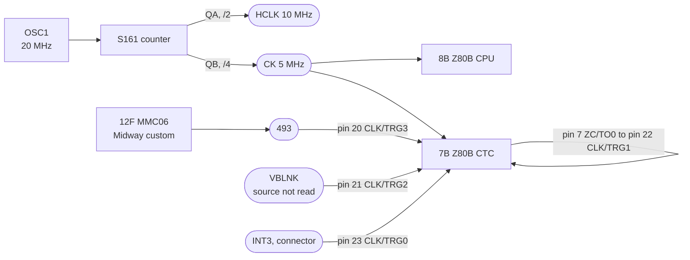

# MCR 91490 "5 MHz CPU" board: clocks, CTC triggers and sync

The CPU board under Tapper (and, per the board-stack lists, Discs of Tron and
Demolition Derby). It replaces MCR II's Super CPU `A084-90010`; the Super Sound
I/O behind it is unchanged. What is read here is the part of the board the
emulation's timing rests on: the oscillator and its dividers, the CTC's trigger
inputs, and the sync decode. Model: `machines/src/mcr_91490.rs`.

## Provenance

| | |
|---|---|
| Drawing | 5 MHz CPU schematic `A080-91490-H000`, drawn 12/16/83, project engineer R. Weyand |
| Read from | `arcarc.xmission.com/PDF_Arcade_Bally_Midway/Tapper_Parts_and_Operating_Manual_(Dec_1983).pdf`, PDF page 25 |
| Also read | Option switch card `M051-00A11-A007`, same PDF, page 5 |
| Transcribed | 2026-10-11, from the PDF's embedded 400 dpi CCITT image |

The PDF has no text layer. Pages 20 to 30 are the schematics, one 12224-pixel
wide image each; page 21 is the video board, not this one.

## The circuit

## Parts

| Ref | Part | Role |
|---|---|---|
| OSC1 | 20 MHz oscillator | the board's only crystal source |
| (unlabeled) | 74S161 | divides OSC1: `QA` (pin 14) to `HCLK` through an S04, `QB` (pin 13) to `CK` |
| 8B | Z80B | main CPU, clocked by `CK` |
| 7B | Z80B CTC | interrupt source, clocked by `CK` on pin 15 |
| 11B2 | MMC01 | Midway custom: horizontal counter, outputs `H2`..`H9` |
| 12F | MMC06 | Midway custom: takes `DV0`..`DV6`, outputs `DV7`, `DV8`, `493`, `AV3` |

## Nets

| Net | Pins |
|---|---|
| `CK` | S161.13 (`QB`), 7B.15 (CTC CLK) |
| `HCLK` | S161.14 (`QA`) through 6A S04 |
| `493` | 12F.13, 7B.20 |
| `VBLNK` | 7B.21; on the bus beside 12F, source pin not read |
| `INT3` | 7B.23 |
| ZC/TO0 loop | 7B.7 to 7B.22 |
| `DV0`..`DV6` | 12F.3 to 12F.9 (inputs) |
| `DV7`, `DV8` | 12F.11, 12F.12 |

## What it establishes

- **The CPU is at 5 MHz and the dot clock at 10 MHz**, both from one 20 MHz
  source. The dot clock is twice the CPU clock (MCR II's is four times), so the
  634-dot line is exactly 317 CPU cycles.
- **The CTC's triggers, by pin.** On this scan the pin numbers agree with the
  Z80 CTC pinout, which the MCR II scan's did not, so they read directly:
  `VBLNK` on channel 2, `493` on channel 3, the external `INT3` on channel 0,
  and channel 0's zero-count output looped to channel 1's trigger. That loop is
  the one `mcr2.rs` carries from the reference driver because its own drawing
  was illegible at the pins; this drawing confirms it.
- **The horizontal decode names `634` and `317`.** `634` is the same line-length
  decode MCR II has. `317` is half of it.

## What it does NOT establish

- **What `317` does, exactly.** It is gated with `634` into the counter's load
  (`PLC`) through a 74LS74 at 10F, clocked from a gate on `HBLNK`, `H5`, `H6`
  and `VOO`. That reads like a half-line for the interlace, but its period was
  not traced, and the model takes the frame as 512 full lines.
- **Where the 480 visible lines sit in the 512, and which field paints which
  row.** The upper vertical count and the `493` decode are inside MMC06, and
  where `VBLNK` is generated was not found on this sheet. Same negative result
  as [`mcr-video-timing.md`](mcr-video-timing.md) for MCR II's MMC02, and it
  keeps this board on a whole-frame render for the same reason.
- **Where `DV0`..`DV6` are counted.** They arrive at 12F as inputs; their
  source was not traced.
- **The `CPU WAIT` logic.** Flip-flops at 5C, 6C and 6D combine `H2`, `H3`,
  `VBLNK`, `BuWR`, `BKEN` and `CK` into `uWAIT` and a `CPU WAIT` line. Its
  condition is not transcribed, and the model runs every CPU cycle at full
  speed.

## Option switches (PDF page 5)

Switch 1 is at B3 and Switch 3 at D14, both on the Sound I/O board: the same
positions as Satan's Hollow's Super Sound I/O. On Switch 1, SW#3 is attract-mode
sounds, SW#7 is cocktail/upright and SW#10 is freeze video; SW#1, 2, 4, 5, 6, 8
and 9 are marked not used. The factory setting is SW#3 off (no attract sounds)
and SW#7 off (upright). Switch 3 is the sound board's diagnostics, all off for
play. Coinage and the other common options are set in self-test and kept in
NVRAM.
